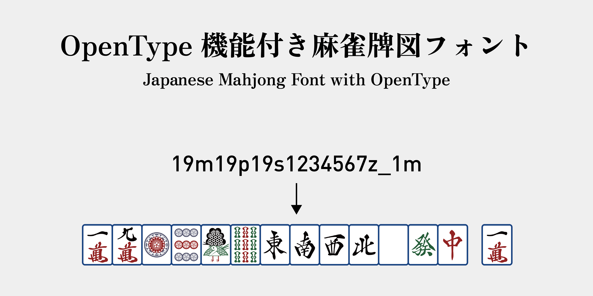

<div align="center">

<h2>Mahjong Font and tile image generator</h2>
<h3>OpenType 機能付き麻雀牌図フォント / 麻雀牌図作成ツール</h3>

🔗&nbsp;&nbsp;Playground: https://mahjong.chingru.com/ &nbsp;&nbsp;🔗


[_/_MIT_(Code)-yellow.svg)](./LICENSE-FONT)


[](https://github.com/rutopio/ui)

Hosted on 




[[Notation (en)]](#notation) ・ [[表記法 (ja)]](#表記法) ・ [[表記方式 (zh)]](#表記方式)


</div>

## Notation

1. Man (**M**anzu): `1m` to `9m`
2. Pin (**P**inzu): `1p` to `9p`
3. Sou (**S**ouzu): `1s` to `9s`
4. Zi (**Z**ihai): `1z` to `7z` (winds, then dragons)
   - `1z`: East (Higashi)
   - `2z`: South (Minami)
   - `3z`: West (Nishi)
   - `4z`: North (Kita)
   - `5z`: White (Haku)
   - `6z`: Green (Hatsu)
   - `7z`: Red (Chun)
5. Dice: `1.` to `6.`
6. Aka-dora (red five): add an asterisk (`*`) after the tile, for example `5p*`, `5s*`, `5m*`.
7. Fuuro (open meld): add a minus sign (`-`) after the called tile, for example `3m3m3m-`, `4s5s-6s`.
   - Chi (sequence): `4s5s-6s`
   - Pon (triplet): `3m3m3m-`
   - Dai-minkan (open quad): `6m6m6m-6m`
8. Ka-kan (added quad): add an equals sign (`=`) after the added tile, for example `3m3m3m-3m=`.
9. An-kan (closed quad): use `0p`, `0s`, `0m`, `0z` for the face-down tiles.

## 表記法

1. 萬子（マンズ）：`1m`~`9m`
2. 筒子（ピンズ）：`1p`~`9p`
3. 索子（ソーズ）：`1s`~`9s`
4. 字牌（ジハイ）：`1z`~`9z`（風牌 - 三元牌順）
   - `1z`：東
   - `2z`：南
   - `3z`：西
   - `4z`：北
   - `5z`：白
   - `6z`：発
   - `7z`：中
5. サイコロ：`1.`~`6.`
6. 赤ドラ：後ろに星マーク（`*`）を付ける。例：`5p*`, `5s*`, `5m*` .
7. 副露（フーロ）：後ろにマイナスマーク（`-`）を付ける。例：
   - 吃（チー）：`4s5s-6s`
   - 碰（ポン）：`3m3m3m-`
   - 大明槓（ダイミンカン）：`6m6m6m-6m`
8. 加槓（カカン）：後ろにイコールマーク（`=`）を付ける。例：`3m3m3m-3m=`.
9. 暗槓（アンカン）：`0p`, `0s`, `0m`, `0z` 牌を裏返し表記。

## 表記方式

1. 萬子：`1m`~`9m`
2. 筒子：`1p`~`9p`
3. 索子：`1s`~`9s`
4. 字牌：`1z`~`9z`（按照風牌 - 三元牌順）
   - `1z`：東
   - `2z`：南
   - `3z`：西
   - `4z`：北
   - `5z`：白
   - `6z`：発
   - `7z`：中
5. 骰子：`1.`~`6.`
6. 赤寶牌：在表記牌的後面加上星號（`*`）。例：`5p*`, `5s*`, `5m*` .
7. 副露：在表記牌的後面加上減號（`-`）。例：
   - 吃：`4s5s-6s`
   - 碰：`3m3m3m-`
   - 大明槓：`6m6m6m-6m`
8. 加槓：在表記牌的後面加上等號（`=`）。例：`3m3m3m-3m=`.
9. 暗槓：使用 `0p`, `0s`, `0m`, `0z` 表示翻過來的牌。

## Development

See [Development toolchain](#development-toolchain) for setup and commands.

## Generate tile data

The app renders tiles as inline SVG. This avoids blank image downloads on iOS
and displays font palette colors consistently across browsers.
The glyph data is extracted ahead of time from the Riichi-Mahjong woff2 fonts
into `src/data/tiles-data.json`, which the web app and the Image API both read.

- Tile glyph data: extract ligatures, SVG paths, bounds and the COLR/CPAL
  palette from `preprocess/fonts/*.woff2` into `src/data/tiles-data.json`.
  Requires Python with [fontTools](https://github.com/fonttools/fonttools).
  Re-run after changing the source fonts:

  ```
  pip install fonttools
  python3 preprocess/extract-tiles.py
  ```

- Web fonts: UI fonts are self-hosted via `@fontsource` packages, imported
  directly in `src/styles/fonts.css` (Vite bundles and hashes the woff2). Paper
  Mono (not on @fontsource) stays as a local `public/fonts/` woff2.

## Image API

Add a tile string to the URL path to generate an SVG image for embedding. The tile path is required (up to 512 characters).
Theme and color fall back to their defaults when omitted.

```
https://mahjong.chingru.com/img/<tile>?theme=color&color=AA7942
```

| Parameter | Location | Type            | Default  | Description                                                                  |
| --------- | -------- | --------------- | -------- | ---------------------------------------------------------------------------- |
| `tile`    | path     | `string`        | required | Tile string (same [notation](#notation)). `_` for a gap, for example `123m456p_5z`. |
| `theme`   | query    | `color \| mono` | `color`  | `color` for colorful tiles, `mono` for monochrome.                                  |
| `color`   | query    | `string` (hex)  | `AA7942` | Main tile color, six-digit hex without `#`. Only applies when `theme=color`.        |

The SVG is rendered at a fixed height of 500px; width scales proportionally.

It is a vector, so you can resize it freely when embedding. For example:

```md

```


Tip: take any share URL from the app and swap `?tile=` for the `/img/` path to
get the matching image. See the [API documentation and examples](https://mahjong.chingru.com/en/api).

## Site files

Static files served from `public/` for crawlers and agents:

- [`robots.txt`](public/robots.txt): allows all crawlers, points to the sitemap.
- [`sitemap.xml`](public/sitemap.xml): lists the page routes across all locales, with hreflang alternates.
- [`llms.txt`](public/llms.txt): project and Image API overview for LLMs,
  following the [llms.txt](https://llmstxt.org/) convention.

## Download fonts

See [Releases](https://github.com/rutopio/mahjong-font/releases).

## License

The source code is licensed under the [MIT License](./LICENSE).

The font files are licensed under the [SIL Open Font License, Version 1.1](./LICENSE-FONT).

## Acknowledgments

- [I.Mahjong - @SyaoranHinata](https://github.com/SyaoranHinata/I.Mahjong/tree/main)
- [Gutenberg Labo](http://gutenberg.osdn.jp)
- [Inconsolata - Google Fonts](https://fonts.google.com/specimen/Inconsolata)
- [Riichi.Wiki](https://riichi.wiki/)

## Development toolchain

Use Node.js 26.13.0 (`nvm use`) and pnpm 12.18.0, as pinned in
`.nvmrc` and `package.json`. Install with `pnpm install --frozen-lockfile`.

| Command | Purpose |
| --- | --- |
| `pnpm dev` | Start the Vite development server. |
| `pnpm build` | Run `check`, then create the production output in `dist/`. |
| `pnpm format` | Format code, organize imports and apply safe Biome lint fixes. |
| `pnpm check` | Check formatting, lint rules, and types for the browser and Pages Functions. |
| `pnpm preview` | Serve the existing production build locally. |

`pnpm format` applies safe fixes. Resolve any remaining errors before running
`pnpm check` again. Use `pnpm outdated`, `pnpm update`, and `pnpm audit` to
maintain dependencies.

`pnpm preview:cf` builds the site and starts the local Cloudflare Pages runtime
with Functions support. Use it when testing server routes; `preview` serves the
static build only.

The five sites share formatting, lint, TypeScript, and pnpm settings. Keep
shared dependency versions aligned when upgrading. Each site maintains its own
aliases, content pipeline, and Cloudflare bindings. Biome does not format CSS.
Tailwind class sorting uses `src/styles/globals.css` and the shared design tokens.

`pnpm-workspace.yaml` records dependency overrides and the security advisories
they address. Remove the `seroval` override when upstream dependencies resolve
a version compatible with `seroval-plugins`.
